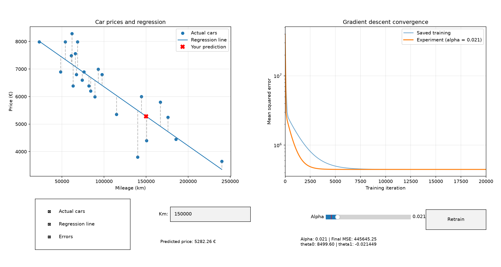

# ft_linear_regression

**A first machine-learning project: predict a car's price from its mileage using linear regression and gradient descent implemented from scratch.**

This project was developed for the **42 Advanced Curriculum** (`ft_linear_regression`, subject version 4.1). Its main purpose is educational: understand *why* linear regression works, write the training algorithm manually, measure its limitations, and visualize the learning process.

The implementation uses Python's standard library for the regression itself. **No library fits the regression line or calculates the learned parameters for us.** Matplotlib is used only for visualization and interactive controls.

## Contents

1. [What the project does](#what-the-project-does)
2. [Machine-learning concepts](#machine-learning-concepts)
3. [The regression equation](#the-regression-equation)
4. [Errors, cost, and gradient descent](#errors-cost-and-gradient-descent)
5. [Why mileage is normalized](#why-mileage-is-normalized)
6. [Worked example: one training iteration](#worked-example-one-training-iteration)
7. [Training results and interpretation](#training-results-and-interpretation)
8. [How the code is organized](#how-the-code-is-organized)
9. [Installation and usage](#installation-and-usage)
10. [Interactive dashboard](#interactive-dashboard)
11. [Model evaluation metrics](#model-evaluation-metrics)
12. [Validation, limitations, and potential improvements](#validation-limitations-and-potential-improvements)
13. [Development process and use of AI](#development-process-and-use-of-ai)

## What the project does

Given a dataset containing a car's **mileage** (`km`) and **price** (`price`), the training program learns the straight line that best fits the observed prices in the least-squares sense. A separate prediction program then uses that line to estimate a price for mileage entered by the user.

The 42 subject requires two programs:

- **Prediction:** ask for mileage and compute `estimatePrice(mileage) = theta0 + theta1 * mileage`. Before training, both theta parameters default to zero.
- **Training:** read the CSV, apply the specified gradient-descent updates, update both theta parameters simultaneously, and save them for the prediction program.

The subject also proposes bonuses: **plotting the dataset and fitted line** and **calculating model precision**. This implementation adds those, plus an interactive dashboard to experiment with the learning rate.

Example using the learned model:

```text
$ python3 predict.py
How many km? 120000
Estimated price: 5925.72 €
```

A prediction is an *estimate*, not a guaranteed market price.

## Machine-learning concepts

| Term | Meaning in this project |
| --- | --- |
| **Machine learning** | Adjusting model parameters using examples instead of manually defining every price. |
| **Supervised learning** | Training on examples with known answers: a mileage and its observed price. |
| **Dataset** | The collected pairs of mileage and price in `data.csv`. |
| **Observation / sample** | One car, represented by its mileage and actual price. |
| **Feature (`x`)** | The input variable: mileage in kilometers. |
| **Target / label (`y`)** | The value to predict: price in euros. |
| **Model / hypothesis** | A mathematical rule mapping mileage to an estimated price. |
| **Parameter** | A learned number in the model, here `theta0` and `theta1`. |
| **Training** | Repeatedly changing parameters to reduce the model's errors. |
| **Prediction / inference** | Using learned parameters for a requested mileage, without retraining. |
| **Residual / prediction error** | Predicted price minus actual price, with sign. |
| **Loss / cost function** | A number measuring how poorly a model fits observations. |
| **Gradient** | The direction and rate at which the cost changes as a parameter changes. |
| **Gradient descent** | Repeatedly moving parameters opposite the gradient to reduce cost. |
| **Learning rate (`alpha`)** | The size of each gradient-descent adjustment. |
| **Iteration** | One full update of both parameters after using all training cars. |
| **Convergence** | The state where further iterations make little or no improvement. |
| **Normalization / scaling** | Changing numerical units of a feature to make calculations better behaved. |
| **Extrapolation** | Predicting beyond the range of mileage represented in training. |

This is **univariate linear regression**: there is one input feature (`km`) and one continuous target (`price`). Unlike classification, it predicts a number, not a category.

## The regression equation

The subject specifies:

$$
\widehat{y} = \theta_0 + \theta_1 x
$$

In the code:

```python
estimated_price = theta0 + theta1 * mileage
```

- **`theta0` (intercept):** the model's estimated price at **0 km**. It shifts the entire line up or down.
- **`theta1` (slope):** the change in predicted price for one additional kilometer. It controls the line's tilt. A negative slope means the predicted price falls as mileage rises.
- **`x` (mileage):** the input, measured in kilometers for the saved model.
- **`ŷ` (prediction):** the price returned by the model.

With the parameters learned from the provided dataset:

$$
\widehat{price} \approx 8499.59965 - 0.0214489636 \times km
$$

For **120,000 km**:

$$
8499.59965 - 0.0214489636\times120000 \approx \boxed{5925.72\text{ €}}
$$

The slope means approximately **€0.02145 less per additional km**, or **€2,144.90 less per 100,000 km**, *according to this particular fitted dataset*. The intercept is a model parameter, not a promise that a real car at zero kilometers would sell for exactly €8,499.60.

## Errors, cost, and gradient descent

### 1. Prediction error

For each training car `i`:

$$
e_i = \widehat{y}_i - y_i
$$

For example, if the model predicts €5,925.72 and the real price is €6,000:

$$
e = 5925.72 - 6000 = -74.28\text{ €}
$$

A **negative** error means the model predicted too low; a **positive** error means it predicted too high. Simply averaging signed errors is insufficient to evaluate accuracy: positive and negative errors can cancel each other.

### 2. Mean squared error (MSE)

To measure the model's overall error, we square each residual and take the mean:

$$
\mathrm{MSE}=\frac{1}{m}\sum_{i=1}^{m}(\widehat{y}_i-y_i)^2
$$

Here, **`m` is the number of cars**. Squaring makes every contribution non-negative and penalizes larger mistakes more heavily. The unit is **euros squared**, not euros.

For deriving the updates, it is convenient to define a closely related cost:

$$
J(\theta_0,\theta_1)=\frac{1}{2m}\sum_{i=1}^{m}(\widehat{y}_i-y_i)^2
$$

The factor `1/2` makes the derivative simpler because differentiating a square produces a factor `2`. **Minimizing this half-MSE gives the same best-fitting line as minimizing MSE.** We monitor regular MSE in the graphs, while the gradient-update formulas in the 42 subject correspond to this half-MSE convention.

### 3. The gradients

For the intercept:

$$
\frac{\partial J}{\partial\theta_0}=\frac{1}{m}\sum_{i=1}^{m}e_i
$$

For the slope:

$$
\frac{\partial J}{\partial\theta_1}=\frac{1}{m}\sum_{i=1}^{m}e_i x_i
$$

**Why multiply by mileage for `theta1`?** Changing the slope has a larger effect on predictions for cars with larger input values; changing the intercept moves all predictions by the same amount. These two gradients measure how each parameter affects total cost.

### 4. Gradient-descent updates

Let `alpha` be the learning rate. The subject's temporary corrections are:

$$
\mathrm{tmpTheta0}=\alpha\,\frac{1}{m}\sum_{i=1}^{m}e_i
$$

$$
\mathrm{tmpTheta1}=\alpha\,\frac{1}{m}\sum_{i=1}^{m}e_ix_i
$$

Then:

$$
\theta_0\leftarrow\theta_0-\mathrm{tmpTheta0}
\qquad
\theta_1\leftarrow\theta_1-\mathrm{tmpTheta1}
$$

**Both temporary corrections must use the same old `theta0` and `theta1`** before either parameter is updated. This is *batch gradient descent*: each iteration uses all `m` observations.

The minus sign matters. The gradient points in the direction of increasing cost; subtracting it moves toward decreasing cost (for a suitable learning rate).

### 5. What alpha changes

A **small** learning rate takes small steps and may require many iterations. A **moderate** rate can converge much faster. A rate that is **too large** may overshoot, oscillate, or diverge.

Alpha generally changes **how quickly** the same cost minimum is approached, **not the location of the minimum**, provided training remains stable and runs long enough. This explains the dashboard observation: below `0.01`, the fitted line can still be visibly different after 20,000 iterations; above `0.01`, several settings can already be close enough to the same optimum that their lines overlap.

## Why mileage is normalized

The dataset's mileage values can reach **240,000 km**, whereas prices are in the thousands. Without scaling, the slope-gradient term `error * mileage` can become enormous and destabilize updates.

During training, the code uses **maximum scaling**:

$$
x_{scaled}=\frac{x}{x_{max}}
\qquad x_{max}=240000
$$

Examples:

| Raw mileage | Scaled mileage |
| ---: | ---: |
| 60,000 km | 0.25 |
| 120,000 km | 0.50 |
| 240,000 km | 1.00 |

This is **maximum scaling**, *not* min-max normalization `(x - min) / (max - min)` and not standardization `(x - mean) / standard_deviation`.

While training, the model's slope is expressed **per scaled mileage unit**:

$$
\widehat{price}=\theta_0+\theta_{1,scaled}\left(\frac{km}{240000}\right)
$$

The learned scaled slope is approximately `-5147.751262`. To let `predict.py` accept raw kilometers directly, we convert it **once after training**:

$$
\theta_{1,raw}=\frac{\theta_{1,scaled}}{240000}
\approx -0.0214489636
$$

`theta0` does **not** change. The model's predictions also do **not** change: these are the same line written in different units. `thetas.json` stores the **raw-kilometer** slope. **Do not divide mileage by 240,000 again in `predict.py`** or the prediction will be wrong.

## Worked example: one training iteration

To see the arithmetic without all 24 cars, imagine three examples. Start with `theta0 = 0`, `theta1 = 0`, and `alpha = 0.01`.

| Car | Scaled mileage (`x`) | Actual price (`y`) | Initial prediction | Error (`prediction - y`) | `error * x` |
| --- | ---: | ---: | ---: | ---: | ---: |
| A | 0.2 | €8,000 | €0 | -8,000 | -1,600 |
| B | 0.5 | €6,000 | €0 | -6,000 | -3,000 |
| C | 1.0 | €4,000 | €0 | -4,000 | -4,000 |

With `m = 3`:

$$
\mathrm{tmpTheta0}=0.01\times\frac{-8000-6000-4000}{3}=-60
$$

$$
\mathrm{tmpTheta1}=0.01\times\frac{-1600-3000-4000}{3}\approx-28.6667
$$

Apply both updates:

$$
\theta_0=0-(-60)=60
\qquad
\theta_1=0-(-28.6667)=28.6667
$$

The next prediction for car A is:

$$
\widehat{y}_A=60+(28.6667\times0.2)\approx65.73
$$

It is still far from €8,000, but higher than the initial €0 prediction. The model repeats this process, recalculating errors with the **new** theta values every iteration. A single update is not expected to fit the data.

## Training results and interpretation

For the supplied **24-car dataset**:

| Setting / result | Value |
| --- | ---: |
| Cars (`m`) | 24 |
| Mileage range | 22,899–240,000 km |
| Price range | €3,650–€8,290 |
| Mileage scaling divisor | 240,000 |
| Learning rate (`alpha`) | 0.01 |
| Training iterations | 100,000 |
| Initial MSE (zero parameters) | 41,761,038.58 |
| Final MSE | 445,645.25 |
| Final `theta0` | 8,499.59965 |
| Final `theta1`, raw km | -0.0214489636 |

The training loss falls sharply at first and then flattens; by approximately **30,000 iterations**, the displayed MSE was already close to its final value. Running more iterations produced almost no further improvement at two-decimal precision.

A minimum MSE **greater than zero is normal**: different cars can have different prices even at similar mileage. The model only uses mileage and can draw only one straight line.

## How the code is organized

```text
ft_linear_regression/
├── data.csv                 # Input dataset
├── train.py                 # Manual gradient descent; saves parameters/history
├── predict.py               # Interactive command-line prediction
├── precision.py             # Metrics on the dataset
├── plot.py                  # Interactive two-panel Matplotlib dashboard
├── thetas.json              # Generated model parameters
├── training_history.json    # Generated MSE history
├── dashboard.png            # Generated snapshot of the dashboard
├── README.md                # Project guide
└── .gitignore               # Ignores virtual environment/cache files
```

Files marked **generated** appear after running the corresponding program; they may not exist in a fresh checkout. There is no need to include an entire virtual environment in Git.

### `train.py`: learning the parameters

1. **`load_dataset()`** reads mileage and prices from the CSV and validates the data.
2. **`normalize_mileages()` or the normalization section of `train_model()`** divides each mileage by the maximum.
3. **`calculate_gradients()` or the gradient loop in `train_model()`** computes the two average gradients manually.
4. **`train_model()`** initializes thetas to zero, repeats simultaneous updates, and records sampled MSE values. It returns the learned thetas and history; the dashboard can call it without saving an experiment.
5. **`save_results()` / JSON-saving code** converts the slope to raw km and writes `thetas.json` and `training_history.json`.
6. **`main()`** coordinates reading, training, and saving.

Function names can differ slightly between refactors; the responsibilities and formulas are the important part.

### Saved model and training history

After training, `thetas.json` has the simple format:

```json
{
    "theta0": 8499.599649932363,
    "theta1": -0.021448963591694757
}
```

The numbers are the result of gradient descent, **not hardcoded constants**. Saving them lets prediction run independently without training again.

`training_history.json` records two matching arrays: iteration numbers and their measured MSE values. The plotting program reads them to display convergence. They are samples from training, not the full dataset or an alternative set of learned parameters.

### `predict.py`: using the model

1. **`load_model()`** loads saved `theta0` and `theta1`, or uses `(0, 0)` when no training file exists.
2. **`get_mileage()`** requests and validates a finite non-negative number.
3. **`estimate_price()`** applies `theta0 + theta1 * mileage` with **raw km**.
4. **`main()`** coordinates these steps and prints the estimate.

### `precision.py`: assessing the fit

Loads the same dataset and model, then calculates **MSE**, **RMSE**, **MAE**, and **R²**. It imports existing helpers rather than copying data-reading and prediction logic.

### `plot.py`: understanding the behavior visually

Loads dataset, saved parameters and training history; creates a **single Matplotlib figure with two subplots**. One graph shows actual cars and the regression line; the other shows MSE against training iteration. Controls update the existing Matplotlib artists rather than recreating entire windows.

### Python language features used

| Python feature | What it does here |
| --- | --- |
| `def` / `return` | Define a reusable function and send results back to its caller. |
| Parameters and default arguments | Let the training function accept a different alpha or iteration count for experiments. |
| Tuple unpacking | Receive several returned values: `theta0, theta1, history = train_model(...)`. |
| Dictionaries | Store named data such as `{"theta0": ..., "theta1": ...}`. |
| `zip(mileages, prices)` | Iterate over corresponding mileage/price pairs together. |
| List comprehension | Build scaled mileages or a list of model predictions. |
| `with` | Automatically close opened files when their block exits. |
| `try` / `except` / `raise` | Handle expected failures or reject invalid input explicitly. |
| `json.dump()` / `json.load()` | Save Python values as JSON and read them back. |
| `Path(__file__).resolve().parent` | Locate the project directory independently of the terminal's working directory. |
| `if __name__ == "__main__"` | Run the command-line workflow only when a file is launched directly, not when imported. |
| Callbacks (`on_clicked`, `on_submit`) | Let Matplotlib call our functions in response to buttons and text input. |
| Mutable shared state | Let dashboard callbacks access the currently selected theta values and mileage. |

The project uses **tabs for indentation**, short function docstrings, descriptive names, and comments for mathematical or design decisions that are not immediately obvious.

### Python design practices used

- **Functions with specific responsibilities:** data loading, prediction, gradient calculation, evaluation, and plotting are separated.
- **Arguments and return values:** mathematical functions receive the data they need rather than depending on hidden global state.
- **`if __name__ == "__main__":`** lets a file be run directly without starting its command-line workflow when its functions are imported elsewhere.
- **`pathlib.Path`** resolves data paths relative to the scripts, working across Windows, Linux, macOS, and WSL without manually detecting the OS.
- **`with` context managers** close CSV/JSON files automatically.
- **Docstrings and explanatory comments** document functions and non-obvious decisions, including simultaneous updates and normalization.
- **Exceptions and validation** reject missing/corrupt files, invalid numerical inputs, and unusable datasets where relevant.
- **Reusable regression functions:** the visualization can retrain with a different alpha without copying the mathematical implementation.
- **No `numpy.polyfit`, scikit-learn regression, or equivalent fitting shortcut:** the required learning algorithm is explicit Python code.

## Installation and usage

**Requirements:** Python 3 and Matplotlib (only for plotting). `csv`, `json`, `math`, and `pathlib` are included in Python's standard library.

### Linux, macOS, or WSL

From the repository root:

```bash
python3 -m venv .venv
source .venv/bin/activate
python3 -m pip install matplotlib
```

On some Debian/Ubuntu installations, creating a virtual environment requires installing the appropriate `python3-venv` package first. Tkinter may be needed for interactive windows (`python3-tk` on Ubuntu), and WSL GUI display support depends on the host setup.

### Windows (PowerShell)

```powershell
py -m venv .venv
.\.venv\Scripts\Activate.ps1
python -m pip install matplotlib
```

If your shell restricts activation scripts, use the virtual environment's `python.exe` directly or follow your system's virtual-environment instructions.

### Run the programs

On Linux/macOS/WSL use `python3`; on Windows use `python` (or `py`).

```bash
# 1. Train and generate thetas.json + training_history.json
python3 train.py

# 2. Ask for mileage and predict a price
python3 predict.py

# 3. Evaluate model fit
python3 precision.py

# 4. Open the interactive dashboard and save dashboard.png
python3 plot.py
```

**Order matters:** run `train.py` before `precision.py` and `plot.py`. The prediction program is designed to work before training too: with no model file, both theta values default to zero.

If plotting reports a non-interactive `Agg` backend, it should still save `dashboard.png`. In a Linux or WSL session with Tk GUI support, you can request Tk explicitly for that run:

```bash
MPLBACKEND=TkAgg python3 plot.py
```

The environment variable is a platform-specific launch option, **not a hardcoded requirement in the Python source**. In a headless environment, view the saved PNG instead of expecting an interactive window.

When finished using the virtual environment:

```bash
deactivate
```

Suggested `.gitignore`:

```gitignore
.venv/
__pycache__/
*.py[cod]
```

Whether to version the generated JSON/PNG examples is a repository decision; if omitted, recreate them with the commands above.

## Interactive dashboard

The dashboard presents **two linked views in one window**:

**Car-price graph**

- Shows the 24 training observations as dots and the fitted regression line.
- Checkboxes toggle the cars, regression line, and dashed **residual** segments.
- A mileage text field displays a predicted price and a marker for mileage inside the observed range.
- Mileage outside the observed range can still produce a mathematical estimate, but is flagged as an extrapolation.

**Gradient-descent graph**

- Shows the original saved MSE history.
- An **Alpha** slider chooses the learning rate for an experimental training run.
- **Retrain** trains from zero parameters for **20,000 iterations**, updates the experimental MSE curve, and updates the regression line, residuals, and entered mileage prediction in the other graph.
- Experiments run **in memory**. They do not overwrite `data.csv`, `thetas.json`, or `training_history.json`. Running `train.py` separately is how the saved model is regenerated.
- The MSE axis uses a logarithmic scale when applicable, making late improvements easier to inspect.

The dashboard uses Matplotlib widgets/callbacks rather than a website or a machine-learning training library. It does **not** currently implement dragging car dots to edit the dataset.



*Image is generated by `plot.py`; it will appear here once `dashboard.png` is saved alongside the README.*

## Model evaluation metrics

For each car, calculate `error = prediction - actual_price`. These measurements are computed on the **same 24 cars used for training**, so they describe *training fit*, not a verified ability to predict unseen cars.

| Metric | Formula | Observed result | Interpretation |
| --- | --- | ---: | --- |
| **MSE** | `sum(error²) / m` | `445,645.25 €²` | Average squared error; heavily penalizes large misses. |
| **RMSE** | `sqrt(MSE)` | `€667.57` | Error magnitude in the original price units, sensitive to large misses. |
| **MAE** | `sum(abs(error)) / m` | `€557.84` | Average absolute difference between predictions and observed prices. |
| **R²** | `1 - SS_res / SS_tot` | `0.7330` | Approximately 73.3% of the observed price variation is accounted for by this model relative to predicting the sample mean. |

For R²:

$$
SS_{res}=\sum_{i=1}^{m}(y_i-\widehat{y}_i)^2
\quad\text{and}\quad
SS_{tot}=\sum_{i=1}^{m}(y_i-\overline{y})^2
$$

When all observed prices are identical, `SS_tot = 0`; R² is not defined in its ordinary form, so the evaluation program reports it as unavailable.

**R² = 0.7330 does not mean “73.3% of predictions are correct.”** It is a statistical measure of fit, and it can even be negative for a sufficiently poor model.

RMSE and MAE describe typical errors in **euros** but do not guarantee that an individual prediction will be within those amounts.

## Validation, limitations, and potential improvements

### Validation and expected behavior

- The model starts with `theta0 = theta1 = 0` before training.
- Both gradient corrections are computed before parameters are updated.
- Mileage is scaled during training, then the saved slope is converted back to raw kilometers.
- Input validation rejects non-numeric, negative, `NaN`, and infinite mileage values.
- The prediction script handles a missing model by using zero parameters and reports malformed saved parameters as errors.
- Model evaluation requires a trained model; otherwise, it tells the user to train first.
- A fitted line can mathematically predict a **negative price** for very large mileage; this is extrapolation, not a program crash. The equation is deliberately not clamped to zero because the subject specifies a linear hypothesis.

### Limitations

- **One feature:** a real car price also depends on age, model, condition, maintenance, market, and many other factors.
- **Only 24 examples:** a small dataset limits confidence in generalization.
- **Linear assumption:** the method fits a straight line even if the real relationship is more complex.
- **Out-of-range predictions:** input far below 22,899 km or above 240,000 km is not supported by comparable examples in the training data.
- **In-sample evaluation:** the reported metrics use training data; there is no separate test set or cross-validation.
- **Fixed training length:** the saved model is trained for a chosen number of iterations rather than automatically stopping at convergence.

Possible follow-up experiments include a separate test set, convergence-based stopping, comparing multiple alpha values systematically, and additional features—but the core single-feature project intentionally remains simple.

## Development process and use of AI

This project was built as a **learning exercise**, not as a request for a prebuilt machine-learning solution.

### How I developed it

1. **Learned the mathematics:** worked through slope, intercept, predictions, residuals, MSE, learning rate, normalization, and the two gradients with small manual examples.
2. **Wrote an initial implementation:** read the CSV in Python, calculated the first predictions and errors, implemented the subject's gradient-descent sums, and fixed a bug where error accumulators were not reset between iterations.
3. **Verified convergence:** compared MSE over 1,000 and then 100,000 iterations, showing how the model moved toward a stable fit.
4. **Separated the programs:** saved raw-kilometer theta parameters in JSON and used them in the independent prediction script; tested valid and invalid inputs.
5. **Added visualization and metrics:** built a scatterplot and regression line, an MSE history graph, and MSE/RMSE/MAE/R² evaluation.
6. **Refactored for maintainability:** moved repeated tasks into functions, added documentation, validated inputs, used portable paths, and made training reusable from an interactive Matplotlib dashboard.
7. **Experimented interactively:** compared learning rates and watched the resulting MSE curves and regression line change.

### AI-assistance disclosure

I used **ChatGPT as a tutor and programming assistant**. It helped explain unfamiliar statistics and Python concepts, proposed debugging experiments, reviewed my output and errors, and suggested cleaner organization and test cases. During later refactoring, it also **provided substantial code examples and complete revised versions of some modules**, including the interactive visualization, which I integrated and tested. It helped draft this documentation.

The learning process included manual calculations, writing and testing the original gradient-descent implementation, running the programs, examining actual outputs, reporting problems, and choosing which improvements to keep. The resulting code and technical decisions remain my responsibility: I should be able to explain the regression equations, normalization, update order, validation, and visualization during peer evaluation.

**In particular, I did not use AI or a third-party regression library to calculate the final theta parameters instead of executing my own gradient descent.** The parameters are produced by the project's training program.

---

**Main takeaway:** `ft_linear_regression` demonstrates that a model can learn an interpretable relationship from data through repeated, mathematically defined parameter updates. The important result is not only the final line, but understanding how it was obtained, when it is useful, and where its predictions can fail.
